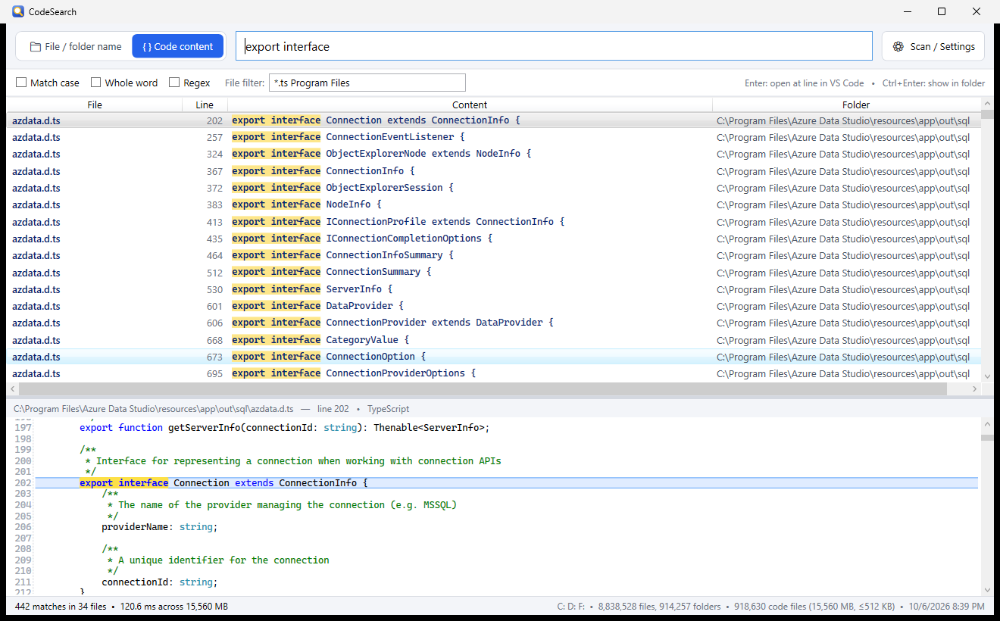

<p align="center">
  
</p>

<h1 align="center">CodeSearch</h1>

<p align="center">
  Instant file-name <b>and</b> code-content search across your Windows drives.<br>
  Like <i>Everything</i> for file names, plus a full-text index of your source code.
</p>

<p align="center">
  <a href="https://github.com/torunf/CodeSearch/releases/latest"><b>Download the installer</b></a>
</p>



## Features

- **Two search modes**, switchable from the top bar (`Ctrl+1` / `Ctrl+2`):
  - **File / folder name**: results update as you type across millions of entries.
  - **Code content**: substring or regex search inside every indexed source file.
- **You choose what gets indexed**: which drives, the maximum file size for the content index (64 KB … 4 MB or any value), which extensions count as code and which folders to skip (`node_modules`, `bin`, `obj`, `.git`, … by default).
- **Fast**:
  - Without admin rights, a parallel directory walker scans the drives.
  - As administrator, CodeSearch reads the NTFS Master File Table directly, like Everything does.
  - Content search uses SIMD over memory-mapped index files.
  - Typical numbers on a developer machine: 1.6 M files named in ~10 s, 4 GB of code indexed in ~30 s, searches in 2–300 ms.
- **Syntax-highlighted preview** with the matching line marked.
  - Built-in highlighting: C#, JavaScript/TypeScript, JSON, HTML, CSS, XML/XAML, C/C++, Java, Python, PHP, PowerShell, SQL, Go, Rust, Kotlin, Swift, Dart, shaders (HLSL/GLSL/Unity), GDScript, Lua, Ruby, Shell, YAML, INI/TOML and more.
- **Open in VS Code at the matching line** with `Enter`, or show the file in Explorer with `Ctrl+Enter`.
- **Multilingual UI**: English, Türkçe, Deutsch, Español, Français. The Windows display language is used by default; you can change it in *Scan / Settings*.
- The index is saved on disk, so the app is ready to search right after start.

## Install

Download `CodeSearch-Setup-<version>-x64.exe` from the [latest release](https://github.com/torunf/CodeSearch/releases/latest) and run it.

- No administrator rights or separate .NET installation are needed. The installer is per-user by default and bundles the runtime.
- Requires Windows 10 or 11, x64.
- On first start, pick the drives and the size limit, then press **Start scan**.

> The installer is not code-signed, so Windows SmartScreen may show a warning. Choose *More info → Run anyway*.

## Search syntax

### File / folder name mode

| Query | Meaning |
|---|---|
| `player controller` | name contains *player* **and** *controller* |
| `!test` | name does not contain *test* |
| `*.cs` / `a?c*` | wildcard match on the whole name |
| `src\util` | the full path contains `src\util` |
| `ext:cs;js` | extension is `cs` or `js` |
| `file:` / `folder:` | only files / only folders |
| `"two words"` | term containing a space |

### Code content mode

- Plain text search by default. Options: **Match case**, **Whole word**, **Regex** (.NET syntax).
- **File filter**, for example `*.cs;*.ts src !test`:
  - Extensions are OR-ed.
  - Other words must appear in the path.
  - `!word` excludes paths that contain the word.

### Keyboard

| Key | Action |
|---|---|
| `Ctrl+1` / `Ctrl+2` / `Ctrl+Tab` | switch mode |
| `Ctrl+F` | focus the search box |
| `↓` | move from the search box into the results |
| `Enter` | open (content mode: VS Code at the line) |
| `Ctrl+Enter` | show in Explorer |
| `Ctrl+C` | copy full paths of the selected results |
| `Esc` | clear the search |

## How it works

- **Name index**: all names are stored in one character blob with parent links, plus a lowercase copy. A query scans that blob in parallel with vectorized `IndexOf`.
- **Content index**: every indexed file is stored twice in large memory-mapped chunk files:
  - original bytes, used for display;
  - ASCII-lowercased bytes, used for case-insensitive search.

  Lowercasing ASCII keeps byte offsets identical, so a hit in the lowercase copy maps directly to the original text.
- **Regex search** uses .NET's linear-time `NonBacktracking` engine when the pattern allows it, so a pathological pattern cannot hang the search.
- **Encodings**: UTF-16 files are converted to UTF-8, BOMs are stripped and binary files are skipped.

Data is stored in `%LOCALAPPDATA%\CodeSearch` (`settings.json` and the `index` folder). The uninstaller asks whether to remove it.

### Privacy and security notes

- Everything stays on your machine; CodeSearch makes no network connections.
- The content index contains copies of your source files, so treat `%LOCALAPPDATA%\CodeSearch` like the files themselves. When you scan as administrator, files from other user profiles that the admin can read may end up in your index.
- Files are never opened through `cmd.exe`. In admin mode, files are opened through Explorer so they do not inherit the elevation.

## Build from source

Requirements:

- .NET 9 SDK
- Windows 10/11
- [Inno Setup 6](https://jrsoftware.org/isinfo.php) for the installer only (`winget install JRSoftware.InnoSetup`)

```powershell
# run from source
dotnet run -c Release

# self-contained exe + installer
.\build-installer.ps1
#   dist\publish\CodeSearch.exe
#   installer\Output\CodeSearch-Setup-<version>-x64.exe
```

## Limitations

- The index is a snapshot. Use **Rescan** after large changes; live change tracking is not implemented yet.
- Case-insensitive content search folds ASCII letters only. Non-ASCII letters such as `ş`, `İ` or `ä` must match exactly.
- The NTFS MFT fast path needs administrator rights and an NTFS volume. Other file systems use the directory walker.

## License

[MIT](LICENSE). Third-party components are listed in [THIRD-PARTY-NOTICES.md](THIRD-PARTY-NOTICES.md).
